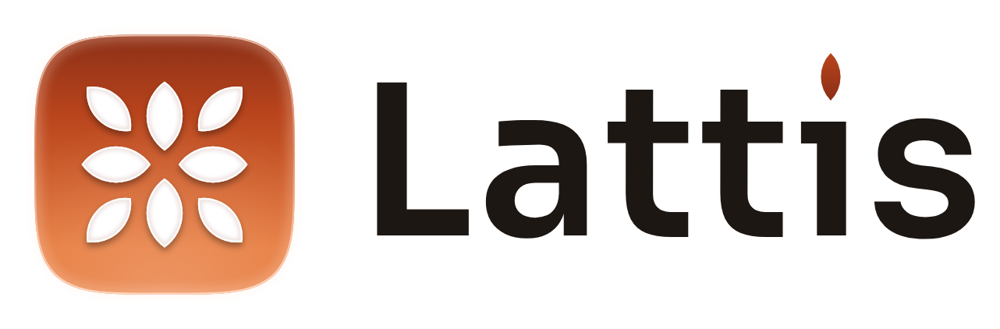
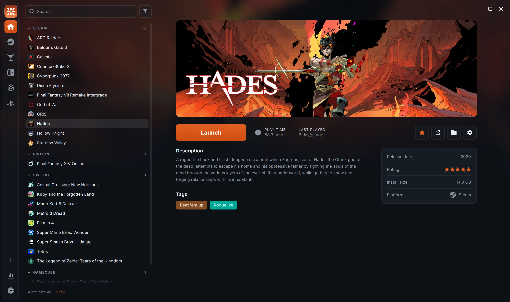
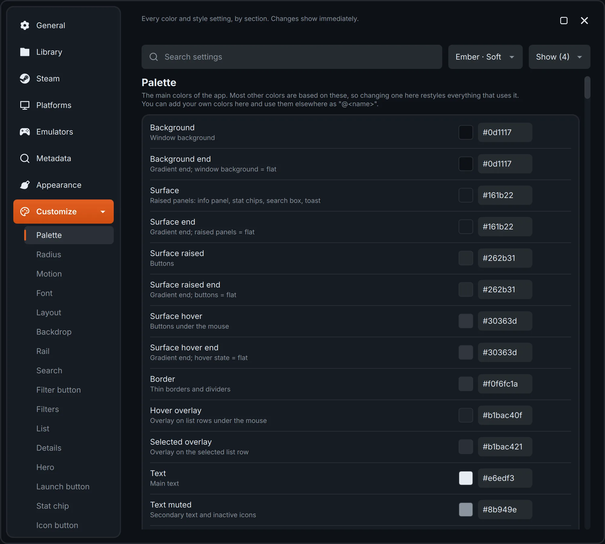
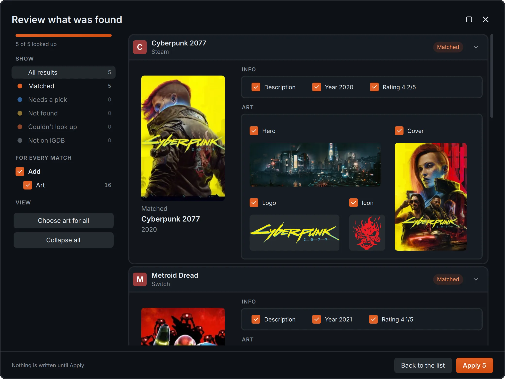
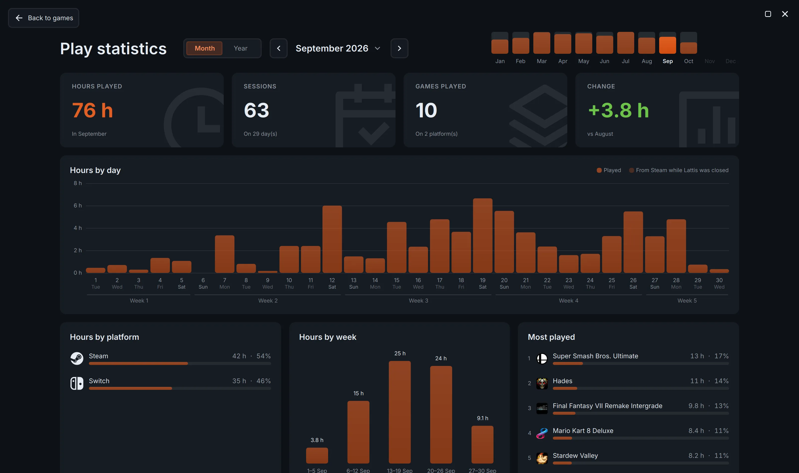
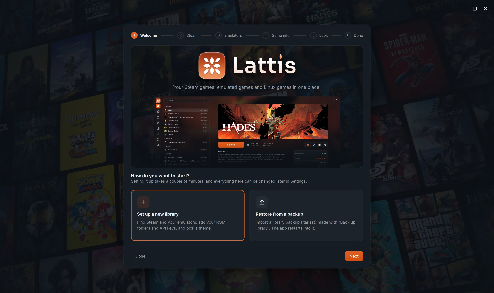

<div align="center">

<picture>
  <source media="(prefers-color-scheme: dark)" srcset="resources/logo/lattis-ember-horizontal.png">
  
</picture>

<br>

**A fast, fully themable game launcher for Linux.**<br>
Emulators, Steam, Proton and native games in one library, kept in one folder you can back up.

[](LICENSE)

[](https://github.com/mines-cmd/lattis/releases/latest)

[Download](https://github.com/mines-cmd/lattis/releases/latest) · [Features](#features) · [Installation](#installation) · [Building from source](#building-from-source) · [Documentation](#documentation)

</div>

<p align="center">
  
</p>

---

## About

Lattis brings every game you own on Linux into a single, fast library: games for twelve emulators, your installed Steam games, Windows games run through Proton, and native Linux games. It's written in C++20 with a Qt Quick interface, starts in a fraction of a second, and lets you change almost everything you see.

## Features

- **One library for everything.** Emulated games, Steam, Windows games through Proton, and native Linux games and AppImages, all with play time, last played, tags and favorites.
- **Emulators made easy.** Add your ROM folders once and new games appear on startup. Twelve presets ship built in, including Ryubing, Azahar, Dolphin, PCSX2 and RPCS3, and you can add emulators of your own.
- **Steam and Proton.** Installed Steam games appear automatically. Windows games run through Proton as non-Steam shortcuts that Lattis manages for you, with preset launch options like MangoHud.
- **Art and metadata.** Hero art, covers, logos and icons from SteamGridDB, and descriptions, release years, ratings and tags from IGDB, one game at a time or in bulk, reviewed before anything is saved.
- **Find anything.** Search that ignores accents and word order; filters for installed, favorites, status, tags and hidden games; sorting by title, last played or play time, grouped by platform or status.
- **Make it yours.** Pick colors and a style separately, mix any with any, and save the pair as a theme. Edit them live in Settings with undo, or in plain TOML files that apply the moment you save.
- **One folder to back up.** Your library, settings, themes and art live in a single data folder. Copy it, or use the built-in backup and import of your library and saves.
- **Guided first start.** A short setup guide imports Steam, finds your emulators and ROM folders, and sets up art lookups and your look.

## Screenshots

| | |
|---|---|
|  |  |
| **Edit any color live, with undo** | **Review metadata and art before anything is saved** |
|  |  |
| **Play statistics** | **A guided first start** |

## Installation

Lattis ships as an AppImage: a single file with everything it needs, which runs on x86_64 Ubuntu 22.04, Debian 12, Fedora 36, SteamOS 3 or newer.

1. Download `Lattis-<version>-x86_64.AppImage` from the [latest release](https://github.com/mines-cmd/lattis/releases/latest).
2. Make it executable: right-click it → Properties → "Allow executing as a program", or run:

   ```sh
   chmod +x Lattis-*.AppImage
   ```

3. Double-click it to start. A setup guide walks you through the first start.

Keeping it in `~/Applications` is a good habit; tools like [Gear Lever](https://flathub.org/apps/it.mijorus.gearlever) can add it to your app menu. To open Lattis when you log in, turn on **Start at login** in Settings → General. See [Getting started](docs/guide/getting-started.md) in the user guide for more.

## Building from source

### Requirements

- A C++20 compiler (GCC or Clang)
- CMake 3.21+ and Ninja
- Qt 6.8+ (Quick, QuickControls2, ShaderTools)
- toml++ 3
- libarchive 3.6+

On Fedora:

```sh
sudo dnf install qt6-qtbase-devel qt6-qtdeclarative-devel qt6-qtshadertools-devel tomlplusplus-devel libarchive-devel cmake ninja-build
```

### Build and run

```sh
cmake --preset default
cmake --build build
./build/lattis
```

The `default` preset builds `RelWithDebInfo` into `build/`. Run the tests with:

```sh
ctest --test-dir build
```

## Configuration

Everything Lattis stores lives in `~/.local/share/lattis/`:

| Path | Contents |
|---|---|
| `settings.toml` | The active colors and style, list sorting and filters, launch settings, and Steam options |
| `library/` | Your games, one file each, plus platforms and tags |
| `art/<game id>/` | Each game's hero, cover, logo and icon |
| `themes/colors/`, `themes/styles/` | Your colors and styles, and your changes to the built-in ones |
| `themes/*.toml` | Your themes, each naming a pair of colors and a style |
| `credentials.toml` | Your IGDB and SteamGridDB keys, readable only by you |

`themes/colors/reference.toml` and `themes/styles/reference.toml` list every setting with its default and a description. See [Themes](docs/guide/themes.md) and [The data folder](docs/guide/data-folder.md) for details.

## Documentation

| | |
|---|---|
| [User guide](docs/guide/README.md) | How to use every part of the app |
| [Roadmap](docs/guide/roadmap.md) | The bigger features planned next |
| [Code documentation](docs/code/) | How the code works, one page per part: library, launching, Steam, themes, QML and more |

## Disclaimer

Lattis was developed with the help of AI coding assistants. All code is directed, reviewed and tested by the author, who is responsible for it.

Lattis isn't affiliated with or endorsed by Valve, Nintendo, Sony, Microsoft or any emulator project. Game titles, platform names and logos are trademarks of their respective owners and are used only for identification.

## License

Copyright © 2026 mines-cmd

Lattis is free software: you can redistribute it and/or modify it under the terms of the [GNU General Public License](LICENSE) as published by the Free Software Foundation, either version 3 of the License, or (at your option) any later version. It is distributed in the hope that it will be useful, but without any warranty; see the license for details.

`SPDX-License-Identifier: GPL-3.0-or-later`

## Credits

- Icons from [Remix Icon](https://remixicon.com), licensed under the Remix Icon License v1.0.
- The gamepad icon is "game controller" by Milinda Courey from [Noun Project](https://thenounproject.com/browse/icons/term/game-controller/), licensed under [CC BY 3.0](https://creativecommons.org/licenses/by/3.0/) (scaled; face buttons spaced apart).
- The Wii U, Wii, GameCube, Linux and home icons are redrawn or traced from the "Nintendo Wii U", "Wii", "Nintendo GameCube", "Penguin" and "Home" icons by [Icons8](https://icons8.com). They're part of the release builds only; built from source, Lattis shows stand-ins for them.
- Game metadata from [IGDB](https://www.igdb.com) and art from [SteamGridDB](https://www.steamgriddb.com), using your own API keys.
